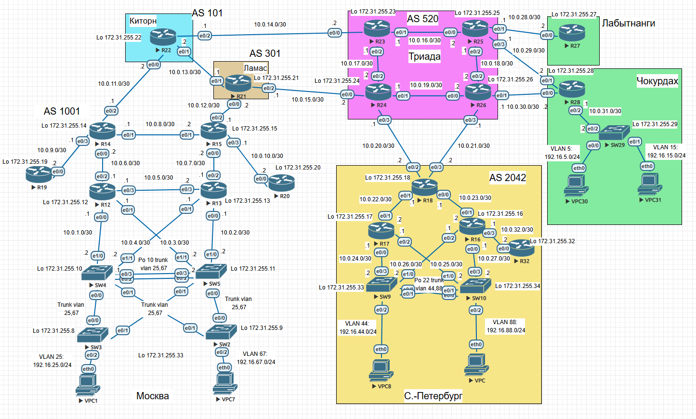

# Домашнее задание Проектирование сети

### Цель:
1. Распланировать адресное пространство.
2. Настроить IP на активных портах для дальнейшей работы над проектом и задокументировать адресацию.

###  Решение:

1. Разработать и задокументируете адресное пространство для лабораторного стенда.
2. Настроить ip адреса на каждом активном порту.
3. Настроить каждый VPC в каждом офисе в своем VLAN.
4. Настроить VLAN/Loopbackup interface управления для сетевых устройств.
5. Настроить сети офисов так, чтобы не возникало broadcast штормов, а использование линков было максимально оптимизировано.
6. Используется IPv4.

### 1. Общая таблица адресного пространства (Network Plan)
Сводный реестр подсетей, стыков и пользовательских сегментов по логическим блокам и устройствам.

| Network IPv4 | Summary net | Description | Eq&port |
| :--- | :--- | :--- | :--- |
| `172.31.255.0/24` | not used | Пул адресов Loopback для маршрутизаторов и коммутаторов | Все R* / SW* Loopback0 |
| `10.0.1.0/30` | 10.0.0.0/16 | Стык ядра Москвы с маршрутизатором R12 | R12e0/0, SW4e1/0 |
| `10.0.2.0/30` | 10.0.0.0/16 | Стык ядра Москвы с маршрутизатором R13 | R13e0/0, SW5e1/0 |
| `10.0.3.0/30` | 10.0.0.0/16 | Стык R12 с коммутатором SW5 | R12e0/1, SW5e1/1 |
| `10.0.4.0/30` | 10.0.0.0/16 | Стык R13 с коммутатором SW4 | R13e0/1, SW4e1/1 |
| `10.0.5.0/30` | 10.0.0.0/16 | Стык R12 с R13 | R12e0/3, R13e0/3 |
| `10.0.6.0/30` | 10.0.0.0/16 | Стык R12 с R14 | R12e0/2, R14e0/0 |
| `10.0.7.0/30` | 10.0.0.0/16 | Стык R13 с R15 | R13e0/2, R15e0/0 |
| `10.0.8.0/30` | 10.0.0.0/16 | Стык R14 с R15 | R14e0/1, R15e0/1 |
| `10.0.9.0/30` | 10.0.0.0/16 | Стык R14 с R19 | R14e0/3, R19e0/0 |
| `10.0.10.0/30` | 10.0.0.0/16 | Стык R15 с R20| R15e0/3, R20e0/0 |
| `10.0.11.0/30` | 10.0.0.0/16 | Транзитный стык R14 с R22 | R14e0/2, R22e0/0 |
| `10.0.12.0/30` | 10.0.0.0/16 | Транзитный стык R15 с R21 | R15e0/2, R21e0/0 |
| `10.0.13.0/30` | 10.0.0.0/16 | Стык R21 с R22 | R21e0/1, R22e0/1 |
| `10.0.14.0/30` | 10.0.0.0/16 | Стык R22 с R23 | R22e0/2, R23e0/0 |
| `10.0.15.0/30` | 10.0.0.0/16 | Стык R21 с R24 | R21e0/2, R24e0/0 |
| `10.0.16.0/30` | 10.0.0.0/16 | Стык R23 с R25 | R23e0/1, R25e0/0 |
| `10.0.17.0/30` | 10.0.0.0/16 | Стык R23 с R24 | R23e0/2, R24e0/2 |
| `10.0.18.0/30` | 10.0.0.0/16 | Стык R25 с R26 | R25e0/2, R26e0/2 |
| `10.0.19.0/30` | 10.0.0.0/16 | Стык R24 с R26 | R24e0/1, R26e0/0 |
| `10.0.20.0/30` | 10.0.0.0/16 | Транзитный стык R24 с R18 | R24e0/3, R18e0/2 |
| `10.0.21.0/30` | 10.0.0.0/16 | Транзитный стык R26 с R18 | R26e0/3, R18e0/3 |
| `10.0.22.0/30` | 10.0.0.0/16 | Стык R18 с R17 | R18e0/1, R17e0/1 |
| `10.0.23.0/30` | 10.0.0.0/16 | Стык R18 с R16 | R18e0/0, R16e0/1 |
| `10.0.24.0/30` | 10.0.0.0/16 | Стык R17 с SW9 | R17e0/0, SW9e0/3 |
| `10.0.25.0/30` | 10.0.0.0/16 | Стык R17 с SW10 | R17e0/2, SW10e1/0 |
| `10.0.26.0/30` | 10.0.0.0/16 | Стык R16 с SW9| R16e0/2, SW9e1/0 |
| `10.0.27.0/30` | 10.0.0.0/16 | Стык R16 с SW10 | R16e0/0, SW10e0/3 |
| `10.0.28.0/30` | 10.0.0.0/16 | Транзитный стык R25 с R27 | R25e0/1, R27e0/0 |
| `10.0.29.0/30` | 10.0.0.0/16 | Транзитный стык R25 с R28 | R25e0/3, R28e0/1 |
| `10.0.30.0/30` | 10.0.0.0/16 | Транзитный стык R26 с R28 | R26e0/1, R28e0/0 |
| `10.0.31.0/30` | 10.0.0.0/16 | Стык R28 с SW29| R28e0/2, SW29e0/2|
| `10.0.32.0/30` | 10.0.0.0/16 | Стык R16 с R32 | R16e0/3, R32e0/0 |
| `192.168.25.0/24` | 192.168.0.0/16 | Пользовательская сеть VLAN 25 (Москва) | SW4 Vlan25, SW5Vlan25 |
| `192.168.67.0/24` | 192.168.0.0/16 | Пользовательская сеть VLAN 67 (Москва) | SW4 Vlan67, SW5 Vlan67 |
| `192.168.44.0/24` | 192.168.0.0/16 | Пользовательская сеть VLAN 44 (С.-Петербург) | SW9 Vlan44, SW10 Vlan44 |
| `192.168.88.0/24` | 192.168.0.0/16 | Пользовательская сеть VLAN 88 (С.-Петербург) | SW9 Vlan88, SW10 Vlan88 |
| `192.168.5.0/24` | 192.168.0.0/16 | Пользовательская сеть VLAN 5 (Чокурдах) | SW29 Vlan5 |
| `192.168.15.0/24` | 192.168.0.0/16 | Пользовательская сеть VLAN 15 (Чокурдах) | SW29 Vlan15 |

---

### 2. Таблица адресов на интерфейсах устройств (Interface Addressing)
Детальная таблица конфигурации интерфейсов:

| Equip | Port | AddrTyp | Address | Network | Description |
| :--- | :--- | :--- | :--- | :--- | :--- |
| **R12** | Loopback0 | IPv4 | `172.31.255.12/32` | — | Router ID |
| **R12** | e0/0 | IPv4 | `10.0.1.1/30` | `10.0.1.0/30` | R12 to SW4 |
| **R12** | e0/1 | IPv4 | `10.0.3.1/30` | `10.0.3.0/30` | R12 to SW5 |
| **R12** | e0/2 | IPv4 | `10.0.6.1/30` | `10.0.6.0/30` | R12 to R14 |
| **R12** | e0/3 | IPv4 | `10.0.5.1/30` | `10.0.5.0/30` | R12 to R13 |
| **R13** | Loopback0 | IPv4 | `172.31.255.13/32` | — | Router ID |
| **R13** | e0/0 | IPv4 | `10.0.2.1/30` | `10.0.2.0/30` | R13 to SW5 |
| **R13** | e0/1 | IPv4 | `10.0.4.1/30` | `10.0.4.0/30` | R13 to SW4 |
| **R13** | e0/2 | IPv4 | `10.0.7.1/30` | `10.0.7.0/30` | R13 to R15 |
| **R13** | e0/3 | IPv4 | `10.0.5.2/30` | `10.0.5.0/30` | R13 to R12 |
| **R14** | Loopback0 | IPv4 | `172.31.255.14/32` | — | Router ID |
| **R14** | e0/0 | IPv4 | `10.0.6.2/30` | `10.0.6.0/30` | R14 to R12 |
| **R14** | e0/1 | IPv4 | `10.0.8.1/30` | `10.0.8.0/30` | R14 to R15 |
| **R14** | e0/2 | IPv4 | `10.0.11.1/30` | `10.0.11.0/30` | R14 to R22 (Transit) |
| **R14** | e0/3 | IPv4 | `10.0.9.1/30` | `10.0.9.0/30` | R14 to R19 |
| **R15** | Loopback0 | IPv4 | `172.31.255.15/32` | — | Router ID |
| **R15** | e0/0 | IPv4 | `10.0.7.2/30` | `10.0.7.0/30` | R15 to R13 |
| **R15** | e0/1 | IPv4 | `10.0.8.2/30` | `10.0.8.0/30` | R15 to R14 |
| **R15** | e0/2 | IPv4 | `10.0.12.1/30` | `10.0.12.0/30` | R15 to R21 (Transit) |
| **R15** | e0/3 | IPv4 | `10.0.10.1/30` | `10.0.10.0/30` | R15 to R20 |
| **R16** | Loopback0 | IPv4 | `172.31.255.16/32` | — | Router ID |
| **R16** | e0/0 | IPv4 | `10.0.27.1/30` | `10.0.27.0/30` | R16 to SW10 |
| **R16** | e0/1 | IPv4 | `10.0.23.2/30` | `10.0.23.0/30` | R16 to R18 |
| **R16** | e0/2 | IPv4 | `10.0.26.1/30` | `10.0.26.0/30` | R16 to SW9 |
| **R16** | e0/3 | IPv4 | `10.0.32.1/30` | `10.0.32.0/30` | R16 to R32 |
| **R17** | Loopback0 | IPv4 | `172.31.255.17/32` | — | Router ID |
| **R17** | e0/0 | IPv4 | `10.0.24.1/30` | `10.0.24.0/30` | R17 to SW9 |
| **R17** | e0/1 | IPv4 | `10.0.22.2/30` | `10.0.22.0/30` | R17 to R18 |
| **R17** | e0/2 | IPv4 | `10.0.25.1/30` | `10.0.25.0/30` | R17 to SW10 |
| **R18** | Loopback0 | IPv4 | `172.31.255.18/32` | — | Router ID |
| **R18** | e0/0 | IPv4 | `10.0.23.1/30` | `10.0.23.0/30` | R18 to R16 |
| **R18** | e0/1 | IPv4 | `10.0.22.1/30` | `10.0.22.0/30` | R18 to R17 |
| **R18** | e0/2 | IPv4 | `10.0.20.2/30` | `10.0.20.0/30` | R18 to R24 (Transit) |
| **R18** | e0/3 | IPv4 | `10.0.21.2/30` | `10.0.21.0/30` | R18 to R26 (Transit) |
| **R19** | Loopback0 | IPv4 | `172.31.255.19/32` | — | Router ID |
| **R19** | e0/0 | IPv4 | `10.0.9.2/30` | `10.0.9.0/30` | R19 to R14 |
| **R20** | Loopback0 | IPv4 | `172.31.255.20/32` | — | Router ID |
| **R20** | e0/0 | IPv4 | `10.0.10.2/30` | `10.0.10.0/30` | R20 to R15 |
| **R21** | Loopback0 | IPv4 | `172.31.255.21/32` | — | Router ID |
| **R21** | e0/0 | IPv4 | `10.0.12.2/30` | `10.0.12.0/30` | R21 to R15 (Transit) |
| **R21** | e0/1 | IPv4 | `10.0.13.1/30` | `10.0.13.0/30` | R21 to R22 |
| **R21** | e0/2 | IPv4 | `10.0.15.1/30` | `10.0.15.0/30` | R21 to R24 |
| **R22** | Loopback0 | IPv4 | `172.31.255.22/32` | — | Router ID |
| **R22** | e0/0 | IPv4 | `10.0.11.2/30` | `10.0.11.0/30` | R22 to R14 (Transit) |
| **R22** | e0/1 | IPv4 | `10.0.13.2/30` | `10.0.13.0/30` | R22 to R21 |
| **R22** | e0/2 | IPv4 | `10.0.14.1/30` | `10.0.14.0/30` | R22 to R23 |
| **R23** | Loopback0 | IPv4 | `172.31.255.23/32` | — | Router ID |
| **R23** | e0/0 | IPv4 | `10.0.14.2/30` | `10.0.14.0/30` | R23 to R22 |
| **R23** | e0/1 | IPv4 | `10.0.16.1/30` | `10.0.16.0/30` | R23 to R25 |
| **R23** | e0/2 | IPv4 | `10.0.17.1/30` | `10.0.17.0/30` | R23 to R24 |
| **R24** | Loopback0 | IPv4 | `172.31.255.24/32` | — | Router ID |
| **R24** | e0/0 | IPv4 | `10.0.15.2/30` | `10.0.15.0/30` | R24 to R21 |
| **R24** | e0/1 | IPv4 | `10.0.19.1/30` | `10.0.19.0/30` | R24 to R26 |
| **R24** | e0/2 | IPv4 | `10.0.17.2/30` | `10.0.17.0/30` | R24 to R23 |
| **R24** | e0/3 | IPv4 | `10.0.20.1/30` | `10.0.20.0/30` | R24 to R18 (Transit) |
| **R25** | Loopback0 | IPv4 | `172.31.255.25/32` | — | Router ID |
| **R25** | e0/0 | IPv4 | `10.0.16.2/30` | `10.0.16.0/30` | R25 to R23 |
| **R25** | e0/1 | IPv4 | `10.0.28.1/30` | `10.0.28.0/30` | R25 to R27 (Transit) |
| **R25** | e0/2 | IPv4 | `10.0.18.1/30` | `10.0.18.0/30` | R25 to R26 |
| **R25** | e0/3 | IPv4 | `10.0.29.1/30` | `10.0.29.0/30` | R25 to R28 (Transit) |
| **R26** | Loopback0 | IPv4 | `172.31.255.26/32` | — | Router ID |
| **R26** | e0/0 | IPv4 | `10.0.19.2/30` | `10.0.19.0/30` | R26 to R24 |
| **R26** | e0/1 | IPv4 | `10.0.30.1/30` | `10.0.30.0/30` | R26 to R28 (Transit) |
| **R26** | e0/2 | IPv4 | `10.0.18.2/30` | `10.0.18.0/30` | R26 to R25 |
| **R26** | e0/3 | IPv4 | `10.0.21.1/30` | `10.0.21.0/30` | R26 to R18 (Transit) |
| **R27** | Loopback0 | IPv4 | `172.31.255.27/32` | — | Router ID |
| **R27** | e0/0 | IPv4 | `10.0.28.2/30` | `10.0.28.0/30` | R27 to R25 (Transit) |
| **R28** | Loopback0 | IPv4 | `172.31.255.28/32` | — | Router ID |
| **R28** | e0/0 | IPv4 | `10.0.30.2/30` | `10.0.30.0/30` | R28 to R26 (Transit) |
| **R28** | e0/1 | IPv4 | `10.0.29.2/30` | `10.0.29.0/30` | R28 to R25 (Transit) |
| **R28** | e0/2 | IPv4 | `10.0.31.1/30` | `10.0.31.0/30` | R28 to SW29 |
| **R32** | Loopback0 | IPv4 | `172.31.255.32/32` | — | Router ID |
| **R32** | e0/0 | IPv4 | `10.0.32.2/30` | `10.0.32.0/30` | R32 to R16 |
| **SW4** | Loopback0 | IPv4 | `172.31.255.10/32` | — | Switch management |
| **SW4** | e1/0 | IPv4 | `10.0.1.2/30` | `10.0.1.0/30` | SW4 to R12 (Routed port) |
| **SW4** | e1/1 | IPv4 | `10.0.4.2/30` | `10.0.4.0/30` | SW4 to R13 (Routed port) |
| **SW4** | Vlan25 | IPv4 | `192.168.25.252/24` | `192.168.25.0/24` | SVI |
| **SW4** | Vlan25 | IPv4 | `192.168.25.254/24` | `192.168.25.0/24` | Gateway for VLAN 25 |
| **SW4** | Vlan67 | IPv4 | `192.168.67.252/24` | `192.168.67.0/24` | SVI |
| **SW4** | Vlan67 | IPv4 | `192.168.67.254/24` | `192.168.67.0/24` | Gateway for VLAN 67 |
| **SW5** | Loopback0 | IPv4 | `172.31.255.11/32` | — | Switch management |
| **SW5** | e1/0 | IPv4 | `10.0.2.2/30` | `10.0.2.0/30` | SW5 to R13 (Routed port) |
| **SW5** | e1/1 | IPv4 | `10.0.3.2/30` | `10.0.3.0/30` | SW5 to R12 (Routed port) |
| **SW5** | Vlan25 | IPv4 | `192.168.25.253/24` | `192.168.25.0/24` | SVI |
| **SW5** | Vlan25 | IPv4 | `192.168.25.254/24` | `192.168.25.0/24` | Gateway for VLAN 25 |
| **SW5** | Vlan67 | IPv4 | `192.168.67.253/24` | `192.168.67.0/24` | SVI |
| **SW5** | Vlan67 | IPv4 | `192.168.67.254/24` | `192.168.67.0/24` | Gateway for VLAN 67 |
| **SW9** | Loopback0 | IPv4 | `172.31.255.33/32` | — | Switch management |
| **SW9** | e0/3 | IPv4 | `10.0.24.2/30` | `10.0.24.0/30` | SW9 to R17 (Routed port) |
| **SW9** | e1/0 | IPv4 | `10.0.26.2/30` | `10.0.26.0/30` | SW9 to R16 (Routed port) |
| **SW9** | Vlan44 | IPv4 | `192.168.44.252/24` | `192.168.44.0/24` | SVI |
| **SW9** | Vlan44 | IPv4 | `192.168.44.254/24` | `192.168.44.0/24` | Gateway for VLAN 44 |
| **SW9** | Vlan88 | IPv4 | `192.168.88.253/24` | `192.168.88.0/24` | SVI |
| **SW9** | Vlan88 | IPv4 | `192.168.88.254/24` | `192.168.88.0/24` | Gateway for VLAN 88 |
| **SW10** | Loopback0 | IPv4 | `172.31.255.34/32` | — | Switch management |
| **SW10** | e0/3 | IPv4 | `10.0.27.2/30` | `10.0.27.0/30` | SW10 to R16 (Routed port) |
| **SW10** | e1/0 | IPv4 | `10.0.25.2/30` | `10.0.25.0/30` | SW10 to R17 (Routed port) |
| **SW10** | Vlan44 | IPv4 | `192.168.44.3/24` | `192.168.44.0/24` | Gateway for VLAN 44 |
| **SW10** | Vlan88 | IPv4 | `192.168.88.3/24` | `192.168.88.0/24` | Gateway for VLAN 88 |
| **SW29** | Loopback0 | IPv4 | `172.31.255.35/29` | — | Switch management |
| **SW29** | e0/2 | IPv4 | `10.0.31.2/30` | `10.0.31.0/30` | SW29 to R28 (Routed port) |
| **SW29** | Vlan5 | IPv4 | `192.168.5.1/24` | `192.168.5.0/24` | Gateway for VLAN 5 |
| **SW29** | Vlan15 | IPv4 | `192.168.15.1/24` | `192.168.15.0/24` | Gateway for VLAN 15 |
| **SW2** | Loopback0 | IPv4 | `172.31.255.9/32` | — | Access switch management |
| **SW3** | Loopback0 | IPv4 | `172.31.255.8/32` | — | Access switch management |

---

### Дополнительно: Port-Channel и логические интерфейсы (L2)
Так как Port-Channel работает на втором уровне и не имеет IP-адреса, для документации используется отдельный формат описания транкового режима:

| Устройство | Port-Channel | Режим | Разрешенные VLAN | Назначение |
| :--- | :--- | :--- | :--- | :--- |
| **SW4** | Po10 | Trunk 802.1Q | 25, 67 | Связь ядра Москвы с SW5 |
| **SW5** | Po10 | Trunk 802.1Q | 25, 67 | Связь ядра Москвы с SW4 |
| **SW9** | Po20 | Trunk 802.1Q | 44, 88 | Связь ядра С.-Петербурга с SW10 |
| **SW10** | Po20 | Trunk 802.1Q | 44, 88 | Связь ядра С.-Петербурга с SW9 |

### Итоговая схема сети: 
