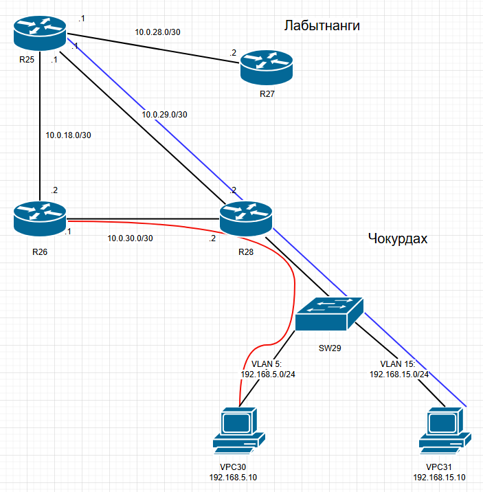

# Домашнее задание

## PBR (Policy-Based Routing)

### Цель

Настроить политику маршрутизации в офисе Чокурдах и распределить трафик между двумя линками.

### Описание / Пошаговая инструкция выполнения домашнего задания

В этой самостоятельной работе мы ожидаем, что вы самостоятельно:

- Настроите политику маршрутизации для сетей офиса.
- Распределите трафик между двумя линками с провайдером.
- Настроите отслеживание линка через технологию IP SLA (только для IPv4).
- Настроите для офиса Лабытнанги маршрут по умолчанию.
- Зафиксируете план работы и изменения в документации.

### 1. Определение трафика (ACL)
Определяю, какой трафик будет перехватываться.

ACL для сети VLAN 5:
```
ip access-list extended PBR_VLAN5
 permit ip 192.168.5.0 0.0.0.255 any
```

ACL для сети VLAN 15:
```
ip access-list extended PBR_VLAN15
 permit ip 192.168.15.0 0.0.0.255 any
```

### 2. Создание Route-Map
Создал Route-Map, который будет перенаправлять трафик для сопоставления с конкретным шлюзом.

Policy-Based Routing для VLAN 5 -> через R26 (10.0.30.1):
```
route-map PBR_VLAN5 permit 10
 match ip address PBR_VLAN5
 set ip next-hop 10.0.30.1
```

Policy-Based Routing для VLAN 15 -> через R25 (10.0.29.1):
```
route-map PBR_VLAN15 permit 10
 match ip address PBR_VLAN15
 set ip next-hop 10.0.29.1
```

### 3. Применение политики PBR
Применил политику PBR к входящему интерфейсу:
```cisco
interface Ethernet0/2.5
 ip policy route-map PBR_VLAN5

interface Ethernet0/2.15
 ip policy route-map PBR_VLAN15
```

### 4. Проверка конфигурации
```
R28#sh ip policy
Interface      Route map
Ethernet0/2.5  PBR_VLAN5
Ethernet0/2.15 PBR_VLAN15

R28#show route-map
route-map PBR_VLAN15, permit, sequence 10
  Match clauses:
    ip address (access-lists): PBR_VLAN15
  Set clauses:
    ip next-hop 10.0.29.1
  Policy routing matches: 0 packets, 0 bytes
route-map PBR_VLAN5, permit, sequence 10
  Match clauses:
    ip address (access-lists): PBR_VLAN5
  Set clauses:
    ip next-hop 10.0.30.1
  Policy routing matches: 0 packets, 0 bytes
R28#
```
### Схема прохождения траффика:



### 5. Настройка IP SLA
Настройка IP SLA.

IP SLA для отслеживания в сторону R26:
```
R28(config)# ip sla 1
R28(config-ip-sla)# icmp-echo 10.0.30.1 source-interface Ethernet0/0
R28(config-ip-sla)# frequency 10
R28(config-ip-sla)# exit
R28(config)# ip sla schedule 1 life forever start-time now
```

IP SLA для отслеживания в сторону R25:
```
R28(config)# ip sla 2
R28(config-ip-sla)# icmp-echo 10.0.29.1 source-interface Ethernet0/1
R28(config-ip-sla)# frequency 10
R28(config-ip-sla)# exit
R28(config)# ip sla schedule 2 life forever start-time now
```

### 6. Настройка объектов Track
Привязал созданные IP SLA к объектам Track.

Для R26:
```
track 1 ip sla 1 reachability
 delay down 90 up 90
```

Для R25:
```c
track 2 ip sla 2 reachability
 delay down 90 up 90
```

### 7. Изменение конфигурации Route-map
Изменил конфигурацию Route-map, заменил next-hop на проверку доступности через track.

Для VLAN 5:
```
R28(config)#route-map PBR_VLAN5 permit 10
R28(config-route-map)# no set ip next-hop 10.0.30.1
R28(config-route-map)#set ip next-hop verify-availability 10.0.30.1 10 track 1
R28(config-route-map)# exit
```

Для VLAN 15:
```
R28(config)#route-map PBR_VLAN15 permit 10
R28(config-route-map)# no set ip next-hop 10.0.29.1
R28(config-route-map)#set ip next-hop verify-availability 10.0.29.1 10 track 2
R28(config-route-map)# exit
```

### Проверка работы IP SLA и PBR

**1. Проверка статистики IP SLA:**
```
R28#show ip sla statistics
IPSLAs Latest Operation Statistics

IPSLA operation id: 1
        Latest RTT: 1 milliseconds
Latest operation start time: 20:14:21 UTC Sat Nov 7 2026
Latest operation return code: OK
Number of successes: 16
Number of failures: 0
Operation time to live: Forever

IPSLA operation id: 2
        Latest RTT: 1 milliseconds
Latest operation start time: 20:14:23 UTC Sat Nov 7 2026
Latest operation return code: OK
Number of successes: 14
Number of failures: 0
Operation time to live: Forever
```
Порты в состоянии UP.

**2. Проверка объектов Track и Route-Map (до сбоя):**
```
R28#show track
Track 1
  IP SLA 1 reachability
  Reachability is Up
    1 change, last change 00:35:53
  Delay up 90 secs, down 90 secs
  Latest operation return code: OK
  Latest RTT (millisecs) 1
  Tracked by:
    Route Map 0
Track 2
  IP SLA 2 reachability
  Reachability is Up
    1 change, last change 00:35:38
  Delay up 90 secs, down 90 secs
  Latest operation return code: OK
  Latest RTT (millisecs) 1
  Tracked by:
    Route Map 0

R28#show route-map
route-map PBR_VLAN15, permit, sequence 10
  Match clauses:
    ip address (access-lists): PBR_VLAN15
  Set clauses:
    ip next-hop verify-availability 10.0.29.1 10 track 2  [up]
  Policy routing matches: 0 packets, 0 bytes
route-map PBR_VLAN5, permit, sequence 10
  Match clauses:
    ip address (access-lists): PBR_VLAN5
  Set clauses:
    ip next-hop verify-availability 10.0.30.1 10 track 1  [up]
  Policy routing matches: 0 packets, 0 bytes
```

**3. Имитация сбоя (выключение интерфейса e0/1 на R26):**
```
R26(config)#interface e0/1
R26(config-if)#shut
```

**4. Проверка реакции системы на сбой:**
```
R28#show track
Track 1
  IP SLA 1 reachability
  Reachability is Down
    2 changes, last change 00:00:10
  Delay up 90 secs, down 90 secs
  Latest operation return code: Timeout
  Tracked by:
    Route Map 0
Track 2
  IP SLA 2 reachability
  Reachability is Up
    1 change, last change 00:40:42
  Delay up 90 secs, down 90 secs
  Latest operation return code: OK
  Latest RTT (millisecs) 1
  Tracked by:
    Route Map 0

R28#show route-map
route-map PBR_VLAN15, permit, sequence 10
  Match clauses:
    ip address (access-lists): PBR_VLAN15
  Set clauses:
    ip next-hop verify-availability 10.0.29.1 10 track 2  [up]
  Policy routing matches: 0 packets, 0 bytes
route-map PBR_VLAN5, permit, sequence 10
  Match clauses:
    ip address (access-lists): PBR_VLAN5
  Set clauses:
    ip next-hop verify-availability 10.0.30.1 10 track 1  [down]
  Policy routing matches: 0 packets, 0 bytes
```

