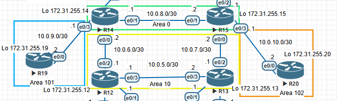

# Домашнее задание: OSPF

## Цель
Настроить OSPF в офисе Москва, разделить сеть на зоны и настроить фильтрацию между зонами.

## Описание / Пошаговая инструкция выполнения домашнего задания

- Маршрутизаторы **R14-R15** находятся в зоне **0** - backbone.
- Маршрутизаторы **R12-R13** находятся в зоне **10**. Дополнительно к маршрутам должны получать маршрут по умолчанию.
- Маршрутизатор **R19** находится в зоне **101** и получает только маршрут по умолчанию.
- Маршрутизатор **R20** находится в зоне **102** и получает все маршруты, кроме маршрутов до сетей зоны **101**.
- План работы и изменения зафиксированы в документации.

## Схема : 




### Зону 10 делаю stub - маршрутизаторы **R12** и **R13** получают все межзоновые маршруты и дополнительно маршрут по умолчанию от **R14** и **R15**.

```
R14(config)#router ospf 1
R14(config-router)#area 10 stub
R14(config)#exit
```

```
R15(config)#router ospf 1
R15(config-router)#area 10 stub
R15(config)#exit
```
```
R12(config)#router ospf 1
R12(config-router)#area 10 stub
R12(config)#exit
```

```
R13(config)#router ospf 1
R13(config-router)#area 10 stub
R13(config)#exit
```

### Таблица маршрутизации **R12**

```
R12#sh ip route
O*IA  0.0.0.0/0 [110/11] via 10.0.6.2, 2d14h, Ethernet0/2
      10.0.0.0/8 is variably subnetted, 8 subnets, 2 masks
C        10.0.5.0/30 is directly connected, Ethernet0/3
L        10.0.5.1/32 is directly connected, Ethernet0/3
C        10.0.6.0/30 is directly connected, Ethernet0/2
L        10.0.6.1/32 is directly connected, Ethernet0/2
O        10.0.7.0/30 [110/20] via 10.0.5.2, 2d14h, Ethernet0/3
O IA     10.0.8.0/30 [110/20] via 10.0.6.2, 2d14h, Ethernet0/2
O IA     10.0.9.0/30 [110/20] via 10.0.6.2, 2d14h, Ethernet0/2
O IA     10.0.10.0/30 [110/30] via 10.0.6.2, 18:33:32, Ethernet0/2
                      [110/30] via 10.0.5.2, 01:38:40, Ethernet0/3
      172.31.0.0/32 is subnetted, 5 subnets
C        172.31.255.12 is directly connected, Loopback0
O        172.31.255.13 [110/11] via 10.0.5.2, 2d14h, Ethernet0/3
O IA     172.31.255.15 [110/21] via 10.0.6.2, 18:33:32, Ethernet0/2
                       [110/21] via 10.0.5.2, 01:38:40, Ethernet0/3
O IA     172.31.255.19 [110/21] via 10.0.6.2, 01:38:40, Ethernet0/2
O IA     172.31.255.20 [110/31] via 10.0.6.2, 18:33:32, Ethernet0/2
                       [110/31] via 10.0.5.2, 01:38:40, Ethernet0/3
```

### Таблица маршрутизации **R13**

```
R13#sh ip route
O*IA  0.0.0.0/0 [110/11] via 10.0.7.2, 18:44:47, Ethernet0/2
      10.0.0.0/8 is variably subnetted, 8 subnets, 2 masks
C        10.0.5.0/30 is directly connected, Ethernet0/3
L        10.0.5.2/32 is directly connected, Ethernet0/3
O        10.0.6.0/30 [110/20] via 10.0.5.1, 01:49:54, Ethernet0/3
C        10.0.7.0/30 is directly connected, Ethernet0/2
L        10.0.7.1/32 is directly connected, Ethernet0/2
O IA     10.0.8.0/30 [110/20] via 10.0.7.2, 18:44:47, Ethernet0/2
O IA     10.0.9.0/30 [110/30] via 10.0.7.2, 18:44:47, Ethernet0/2
                     [110/30] via 10.0.5.1, 01:49:54, Ethernet0/3
O IA     10.0.10.0/30 [110/20] via 10.0.7.2, 18:44:47, Ethernet0/2
      172.31.0.0/32 is subnetted, 5 subnets
O        172.31.255.12 [110/11] via 10.0.5.1, 01:49:54, Ethernet0/3
C        172.31.255.13 is directly connected, Loopback0
O IA     172.31.255.15 [110/11] via 10.0.7.2, 18:44:47, Ethernet0/2
O IA     172.31.255.19 [110/31] via 10.0.7.2, 01:49:54, Ethernet0/2
                       [110/31] via 10.0.5.1, 01:49:54, Ethernet0/3
O IA     172.31.255.20 [110/21] via 10.0.7.2, 18:44:47, Ethernet0/2

```

### Зону 101 делаю totally stubby (no-summary) - R19 получает только маршрут по умолчанию от **R14**

```
R14(config)#router ospf 1
R14(config-router)#area 101 stub no-summary
R14(config)#exit
```

```
R19(config)#router ospf 1
R19(config-router)#area 101 stub no-summary
R19(config)#exit
```
### Таблица маршрутизации **R19**
```
R19#sh ip route

O*IA  0.0.0.0/0 [110/11] via 10.0.9.1, 02:28:24, Ethernet0/0
      10.0.0.0/8 is variably subnetted, 2 subnets, 2 masks
C        10.0.9.0/30 is directly connected, Ethernet0/0
L        10.0.9.2/32 is directly connected, Ethernet0/0
      172.31.0.0/32 is subnetted, 1 subnets
C        172.31.255.19 is directly connected, Loopback0

```

### На ABR **R15** отфильтровать префиксы зоны 101, чтобы они не попадали в таблицу маршрутизации **R20**

```
ip prefix-list AREA101_BLOCK seq 5 deny 172.31.255.19/32
ip prefix-list AREA101_BLOCK seq 7 deny 10.0.9.0/30
ip prefix-list AREA101_BLOCK seq 10 permit 0.0.0.0/0 le 32

```
### Применить prefix-list AREA101_BLOCK в OSPF
```
R15(config)#router ospf 1
R15(config-router)#area 102 filter-list prefix AREA101_BLOCK in

```

### Таблица маршрутизации на **R20** до и после примениния фильтрации маршрутов

#### R20#sh ip route

```
      10.0.0.0/8 is variably subnetted, 7 subnets, 2 masks
O IA     10.0.5.0/30 [110/30] via 10.0.10.1, 00:53:23, Ethernet0/0
O IA     10.0.6.0/30 [110/40] via 10.0.10.1, 00:53:23, Ethernet0/0
O IA     10.0.7.0/30 [110/20] via 10.0.10.1, 00:53:23, Ethernet0/0
O IA     10.0.8.0/30 [110/20] via 10.0.10.1, 00:53:23, Ethernet0/0
O IA     10.0.9.0/30 [110/30] via 10.0.10.1, 00:53:23, Ethernet0/0
C        10.0.10.0/30 is directly connected, Ethernet0/0
L        10.0.10.2/32 is directly connected, Ethernet0/0
      72.0.0.0/24 is subnetted, 1 subnets
O IA     72.72.72.0 [110/31] via 10.0.10.1, 00:00:22, Ethernet0/0
      172.31.0.0/32 is subnetted, 4 subnets
O IA     172.31.255.12 [110/31] via 10.0.10.1, 00:53:23, Ethernet0/0
O IA     172.31.255.13 [110/21] via 10.0.10.1, 00:53:23, Ethernet0/0
O IA     172.31.255.15 [110/11] via 10.0.10.1, 00:53:23, Ethernet0/0
C        172.31.255.20 is directly connected, Loopback0
```


#### R20#sh ip route

```
      10.0.0.0/8 is variably subnetted, 6 subnets, 2 masks
O IA     10.0.5.0/30 [110/30] via 10.0.10.1, 01:05:19, Ethernet0/0
O IA     10.0.6.0/30 [110/40] via 10.0.10.1, 01:05:19, Ethernet0/0
O IA     10.0.7.0/30 [110/20] via 10.0.10.1, 01:05:19, Ethernet0/0
O IA     10.0.8.0/30 [110/20] via 10.0.10.1, 01:05:19, Ethernet0/0
C        10.0.10.0/30 is directly connected, Ethernet0/0
L        10.0.10.2/32 is directly connected, Ethernet0/0
      172.31.0.0/32 is subnetted, 4 subnets
O IA     172.31.255.12 [110/31] via 10.0.10.1, 01:05:19, Ethernet0/0
O IA     172.31.255.13 [110/21] via 10.0.10.1, 01:05:19, Ethernet0/0
O IA     172.31.255.15 [110/11] via 10.0.10.1, 01:05:19, Ethernet0/0
C        172.31.255.20 is directly connected, Loopback0

```

